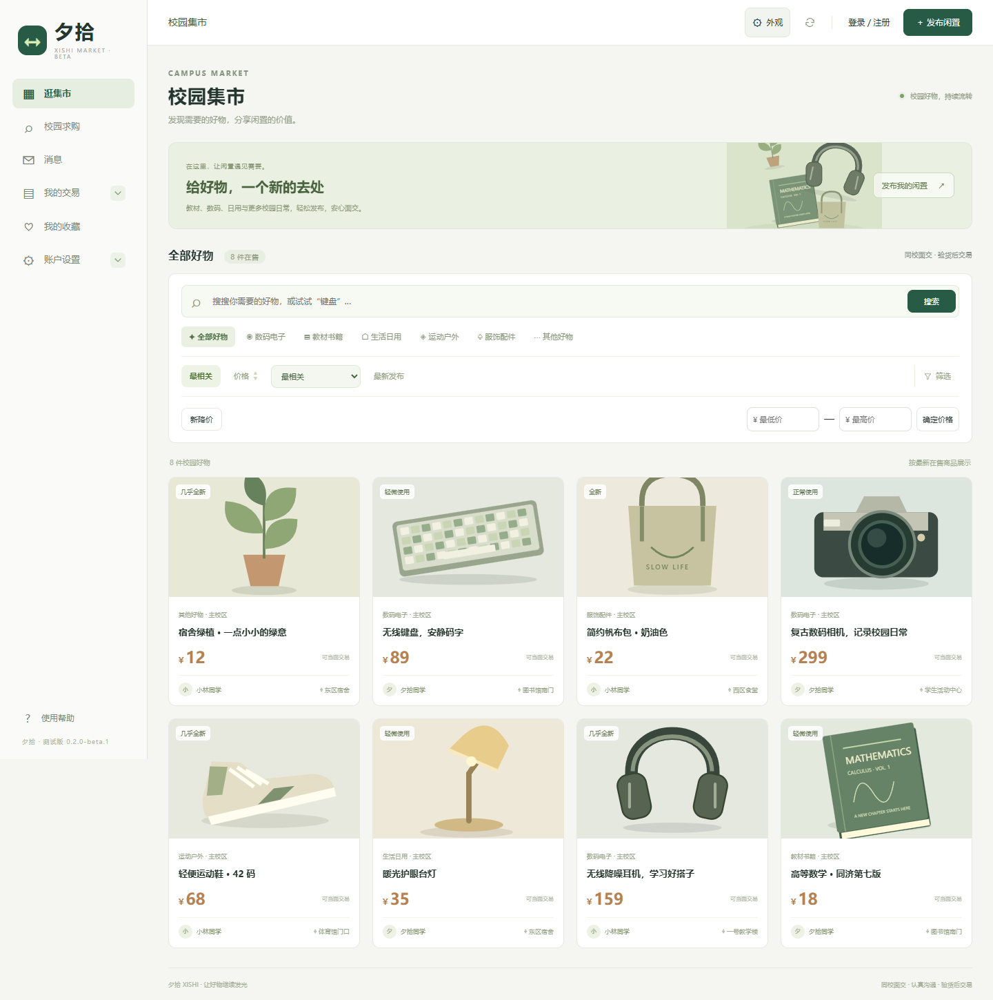

# 夕拾 · 校园二手交易平台

夕拾是面向校园闲置交易的 Web 应用，围绕商品发布、信息发现、私信沟通和线下面交构建交易流程，支持学生与管理员两种角色。

后端采用 **FastAPI + SQLite**，前端采用 **Vue 3**。页面、静态资源和 API 同源提供，支持桌面浏览器与手机 H5，无需单独构建前端。

**当前版本：0.2.0-beta.1（测试版）** · [自动化检查](https://github.com/Fufuzka/xishi-campus-market/actions) · [技术文档](docs/README.md)



## 功能

| 模块 | 能力 |
|---|---|
| 商品管理 | 发布、编辑、上下架、售出标记；1–3 张图片；分类、成色、校区、交易方式和价格 |
| 搜索发现 | 关键词、输入联想、历史搜索；分类／成色多选、组合筛选与分页；相关度、发布时间、价格及最近活跃排序 |
| 降价与收藏 | 真实变价记录、降价筛选、前后价格展示、个人收藏与公开留言 |
| 消息中心 | 商品咨询、求购联系、独立私信；联系人与内容搜索，按消息来源筛选 |
| 交易中心 | 买入／卖出记录、面交安排、取消约定、双方确认完成与历史记录 |
| 账号设置 | 昵称与简介、密码修改、安全问题设置与密码找回 |
| 平台管理 | 学生认证与商品审核、举报处理、用户停用／恢复、分类管理及操作记录 |
| 外观 | 林间集市、轻简横栏、清单浏览；响应式布局与浏览器偏好保存 |

学生认证由管理员人工审核，未接入学校统一身份系统。交易以线下面交为主，不包含在线支付、担保或物流。实验性成交排序仅参考双方确认完成的订单笔数，不代表信用评级。

## 快速开始

需要 **Python 3.11 或 3.12**，首次启动需要联网安装依赖。Vue 和界面素材已随仓库保存。

```sh
git clone https://github.com/Fufuzka/xishi-campus-market.git
cd xishi-campus-market
```

Linux / macOS：

```sh
sh start.sh
```

Windows PowerShell：

```powershell
.\start.ps1
```

打开 [本地应用](http://127.0.0.1:8000)；交互式 API 文档位于 [Swagger UI](http://127.0.0.1:8000/docs)。默认不创建演示账号或管理员。

### 演示数据

仅在独立开发环境中使用 `sh start.sh --demo` 或 `.\start.ps1 -Demo`。初始化账号为 `demo`、`buyer`，密码均为 `Campus2026!`；已有账号时跳过初始化。

`python -m backend.seed_experiments` 可在空数据库导入模拟降价、活跃时间和交易状态。通过 `MARKET_DATA_DIR` 选择独立目录，模拟记录会明确标注。

### 管理员

在项目虚拟环境中执行：

```sh
python -m backend.create_admin admin
```

密码交互输入。普通账号不能自行提权；同名账号不会被覆盖。学生认证与商品发布的审核在“平台管理”完成。

## 部署

CloudStudio 支持单端口启动：

```sh
sh start.sh --cloud
```

使用平台 **8000 端口的 HTTPS 预览**。项目包含 `.vscode/preview.yml`；前端与 API 共用该端口。环境配置、Python 虚拟环境恢复和代理来源设置见 [CloudStudio 部署](docs/15-CloudStudio部署.md)。

其他环境可使用 Python 服务或仓库中的 Docker Compose / Caddy 配置。数据持久化、HTTPS 与备份流程见 [部署与运维](docs/08-部署与运维.md)。

| 环境变量 | 用途 |
|---|---|
| `MARKET_DATA_DIR` | 数据库、商品图片和私有认证材料的持久化目录 |
| `PORT` | Shell 启动脚本监听端口，默认 8000 |
| `MARKET_PUBLIC_ORIGIN` | 外部 HTTPS 站点来源，用于代理场景的跨站提交校验 |
| `COOKIE_SECURE` | HTTPS 环境使用 1；Cloud 模式默认开启 |

## 技术结构

```text
backend/       API、会话与权限、数据迁移、账号恢复
frontend/      Vue 页面、交互、样式和本地静态资源
tests/         接口、权限、状态流转及边界测试
scripts/       启动辅助、浏览器检查、技术文档生成
docs/          功能规格、架构、数据库、API 与部署说明
evidence/      测试结果和界面截图
```

SQLite 使用外键、事务及 WAL；金额按整数分存储。密码和安全答案保存带盐摘要，会话使用 HttpOnly Cookie。认证证明仅本人和管理员可访问。运行数据库、用户上传、凭据、虚拟环境及本地生成文件不纳入版本管理。

## 开发与测试

在安装项目依赖后执行：

```sh
python -m pytest -q
```

GitHub Actions 执行接口回归、JavaScript 语法检查，以及 Python 3.11／3.12 的 Linux 启动检查。浏览器脚本使用 Node.js、Playwright 和 Edge，需在独立测试数据库执行，配置方式见 [开发流程](CONTRIBUTING.md)。测试范围与记录见 [测试报告](docs/06-测试计划与测试报告.md)。

当前仍处于测试阶段。SQLite 面向单实例运行；消息采用轮询；尚未完成大规模负载、完整生产限流及备份恢复专项验证。安全问题找回不是强身份认证方案，具体边界见 [工程审查记录](docs/07-工程审查记录.md)。

## 许可与依赖

第三方组件和素材说明见 [THIRD_PARTY_NOTICES.md](THIRD_PARTY_NOTICES.md)。本仓库尚未声明项目源码的开源许可证。
