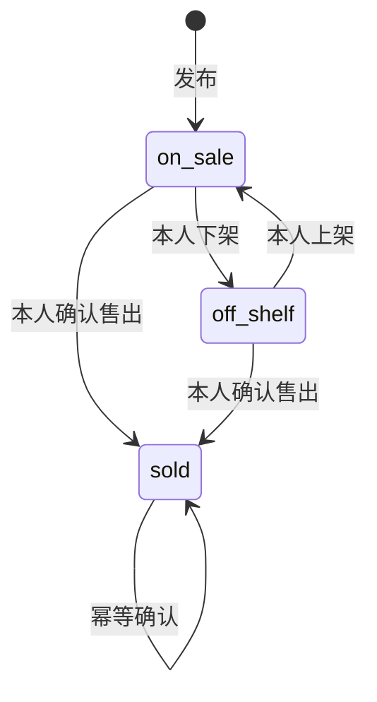

# 校园二手交易集市 · 功能规格说明书（Spec）

> 当前：网页测试版 0.1.0-beta.1（2026-10-19），不作为正式版。下文旧版本号、桌面和历史测试结果仅为开发过程记录；当前运行与部署以 README、10 文档及最新验收记录为准。

文档编号 SGM-SPEC-001 · 版本 1.0 · 日期 2026-10-18 · 状态：实现基线草案，待导师评审

## 1. 项目目标与范围

提供校园内闲置物品信息发布与发现平台，帮助同学联系卖家并线下验货交易。对应题目 3“校园二手交易集市”，采用允许的 FastAPI + Vue 技术栈。必做三项全部纳入，选做的留言询价、收藏和关键词搜索一并实现。

平台只承载商品和沟通信息；支付、物流、担保、订单、商家入驻、管理后台、学生证核验不在本版范围。用户注册未做学籍验证，不能宣称“已认证学生”。示例数据不代表真实交易。

## 2. 角色与权限

| 角色 | 可执行操作 | 限制 |
|---|---|---|
| 游客 | 浏览在售商品、筛选、搜索、查看详情和公开留言 | 不能发布、收藏、留言；不能获取联系方式 |
| 登录用户 / 买家 | 游客操作、发布、收藏、留言、查看联系方式 | 不能修改他人商品，不能替卖家回复 |
| 商品发布者 / 卖家 | 管理本人发布的商品，回复该商品询价 | 所有权由服务端会话和数据库判断，不能由前端传入 |

## 3. 功能需求与可验收标准

| 编号 | 优先级 | 需求 | 验收标准 |
|---|---|---|---|
| FR-01 | 必须 | 注册、登录、退出 | 用户名唯一；错误密码失败；退出后旧会话失效；密码不明文落库 |
| FR-02 | 必须 | 发布二手商品 | 登录后可填写标题、描述、价格、图片、联系方式，新增记录归属当前用户 |
| FR-03 | 必须 | 列表与详情 | 首页仅展示在售商品，详情展示成色、地点、描述、卖家和状态 |
| FR-04 | 必须 | 分类和价格筛选 | 分类可组合最低 / 最高价；边界包含等于；最低大于最高时提示错误 |
| FR-05 | 必须 | 个人管理 | 仅本人可编辑、下架、重新上架、标记售出和查看商品留言 |
| FR-06 | 扩展 | 图片上传 | 支持 JPEG / PNG / WebP；单图不超过 5 MB；无效图片拒绝；输出随机文件名 |
| FR-07 | 选做 | 留言询价与卖家回复 | 登录用户可在在售商品下留言，只有卖家能回复某条根留言 |
| FR-08 | 选做 | 收藏 | 多次收藏只存一条；取消可重复调用；个人收藏与他人隔离 |
| FR-09 | 选做 | 关键词搜索 | 不区分英文大小写搜索标题和描述，能与分类和价格组合 |
| FR-10 | 扩展 | 排序与分页 | 最新、价格升序、价格降序；每页默认 12，最多 48；分页显示总数 |
| FR-11 | 必须 | 状态管理 | 下架和售出不出现在公共列表；售出不可重新上架；非在售停止接收留言 |
| FR-12 | 扩展 | 隐私与响应式 | 游客公共列表不含联系方式；详情提示登录；390px 手机宽度可用且无横向溢出 |

## 4. 输入约束

用户名为 3–30 位字母、数字、下划线；昵称 1–24 字，不能全空白；密码 8–128 位。商品标题 2–80 字、描述 5–3000 字；价格 0–999999 元，最多两位小数，不允许负数、NaN 或无穷；联系方式 2–100 字，交易地点 2–80 字。服务端清理空白并再次验证。

分类固定为数码电子、教材书籍、生活日用、运动户外、服饰配件、其他好物。成色固定为全新、几乎全新、轻微使用、正常使用。图片可来自本地上传路径或 HTTPS 地址；拒绝脚本协议、协议相对链接和路径穿越。留言去除首尾空白后不能为空，最多 500 字。

## 5. 主流程及异常

发布流程：注册 / 登录 → 上传图片或填图片 URL → 填写商品信息 → 客户端检查 → 服务端校验 → 写入商品 → 跳转“我的发布”。任一步失败时保留表单内容并显示错误；上传完成但最终未发布的图片属于遗留文件，清理策略见运维文档。

交易信息流程：买家检索 → 查看详情 → 登录查看联系方式 / 留言 → 卖家回复 → 双方线下面交 → 卖家标记售出。售出弹出确认框，并告知不可重新上架。

无结果显示清除筛选入口；服务不可用显示重试入口；会话过期使受限操作返回 401 并提示重新登录；他人操作返回 403；不存在商品返回 404；状态冲突返回 409；字段无效返回 422。

## 6. 状态规则

状态为 sold 时仍允许发布者编辑说明，但不允许回到在售；重新销售需新建商品。历史收藏仍可查看已下架 / 售出详情，页面明确显示状态。

## 7. 非功能要求与限制

可靠性：SQLite 事务写入，外键有效，金额整数分保存；数据目录持久化。安全性：加盐密码哈希、HttpOnly Cookie、SameSite、跨站 Origin 检查、SQL 参数绑定、所有权校验、上传内容重编码。可维护性：固定依赖版本、独立测试数据库、OpenAPI 文档和可复现脚本。可用性：桌面四列、手机两列，表单标签、错误反馈、键盘焦点可见。

本次没有压力测试和吞吐量承诺，未完成公网环境测试、校园 SSO、内容举报及审核、分布式限流。正式开放校园用户之前需结合学校要求补充这些能力；课程截图验收不等同于生产准入。

## 8. 设计评审门槛

提交本规格、架构、数据库、API、原型给导师；导师确认范围和状态规则后形成 1.1 基线。导师意见尚未取得，因此本版本可运行、可评审，但不能标记为“导师已评审通过”。记录表见 07 文档。

## 9. 1.3.0 已确认扩展

FR-13：历史搜索最多 12 条、按账号 / 游客隔离、复用、删除和确认清空；FR-14：真实在售商品生成可能想搜与输入联想；FR-15：默认相关度、价格点击双向切换和最新发布；FR-16：分类 / 价格 / 成色 / 发布时间组合筛选，草稿确认后应用、取消不生效，条件标签可逐项移除。输入联想与标签功能经用户额外明确确认，详见 12 文档。
