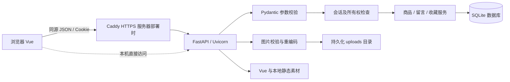
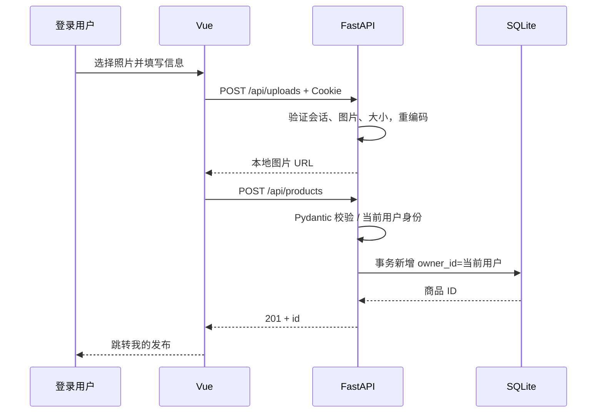

# 架构设计

> 当前：网页测试版 0.1.0-beta.1（2026-10-19），不作为正式版。下文旧版本号、桌面和历史测试结果仅为开发过程记录；当前运行与部署以 README、10 文档及最新验收记录为准。

文档编号 SGM-ARCH-001 · 版本 1.0 · 日期 2026-10-18 · 待导师评审

## 1. 技术选型

| 层次 | 方案 | 选择原因及边界 |
|---|---|---|
| 前端 | Vue 3.5.13，本地全量发行版 | 不需 Node 构建，适合课程交付；页面体积较小时维护直接 |
| API | FastAPI 0.115.12 / Pydantic | 请求模型验证、依赖注入、自动 OpenAPI |
| 服务 | Uvicorn 0.34.2，单工作进程 | 同源服务，降低前后端分离部署的复杂性 |
| 数据 | SQLite，WAL，外键与事务 | 无需额外安装数据库，适合单实例课程项目；高并发扩展需迁移 |
| 图片 | Pillow 解码、压缩，数据目录存储 | 验证真实图片，避免按上传扩展名直接信任文件 |
| 部署 | Python / Docker，Caddy HTTPS | 本机与服务器共用业务代码，容器配置未在本环境实测 |

同源部署不意味着没有前后端分工：Vue 通过 JSON API 与后端通信；FastAPI 额外提供静态文件，省去开发时跨域配置。后端没有依赖 Sites 的 Worker 服务，因为所选技术栈要求 Python FastAPI。

## 2. 总体结构

后端逻辑集中在 `backend/main.py`，按用户、商品、收藏、留言、上传分区，便于课程规模审阅；数据库 DDL 和示例数据独立。后续规模扩大时可按路由 / service / repository 拆分，不应在当前文档虚构已存在的多层目录。

## 3. 模块与数据责任

Vue `app.js` 管理导航、筛选、模态框和表单；所有业务数据经 API 写入，不使用浏览器 localStorage 冒充服务器持久化。用户状态初始化读取 `/api/me`。异步商品列表使用请求序号避免旧响应覆盖新筛选。

认证模块生成 32 字节随机会话，客户端只保存 HttpOnly Cookie；数据库只保存 token 的 SHA-256 摘要，七天到期。密码用 PBKDF2-HMAC-SHA256，260000 次迭代和随机 16 字节盐。登录、退出不向前端返回密码哈希；注销删除对应服务端会话。

商品模块校验字段、将 Decimal 金额转成整数分、实施所有权和状态约束。收藏模块用联合主键和 `INSERT OR IGNORE` 保证幂等。留言模块限制一个根留言加卖家回复的两级结构，拒绝跨商品和回复的回复。

## 4. 发布时序

## 5. 安全与部署边界

API 拒绝不同 Origin 的变更请求；SameSite Cookie 辅助抵御跨站提交。数据库查询参数绑定，排序只能从固定枚举选择。前端用 Vue 文本插值，无 `v-html`。上传仅接受可解码的 JPEG、PNG、WebP，最多 5 MB / 2000 万像素，统一转换为 JPEG 并缩小至 1600px，原始文件名不进入存储路径。

FastAPI 只开放 frontend 资源和 uploads，数据库和源码不作为静态目录。公共列表不返回联系方式；详情仅登录后返回。生产需 HTTPS 与 Secure Cookie；代理请求体限制 6 MB。`forwarded-allow-ips=*` 仅适用于容器 API 端口绑定回环或位于受信反向代理后的配置，不能直接暴露到不可信网络。

## 6. 持久化、故障与未来演进

每个数据库操作创建连接，开启外键，在异常时回滚，finally 关闭；SQLite 锁超时 15 秒，启动启用 WAL。`data/` 保存数据库、WAL 与上传文件，进程重启不丢数据。单实例部署，不承诺跨节点一致性；备份应覆盖数据库一致性快照及 uploads。

未来扩展：按需迁移 PostgreSQL、对象存储、数据库迁移工具、校园 SSO、审核举报与集中限流。当前未实现自动迁移、审计日志、垃圾图片自动清理和登录节流，纳入审查后续项。

参考：[FastAPI 官方文档](https://fastapi.tiangolo.com/)、[Vue 官方快速开始](https://vuejs.org/guide/quick-start.html)。实际依赖版本以项目 lock 文件为准。
