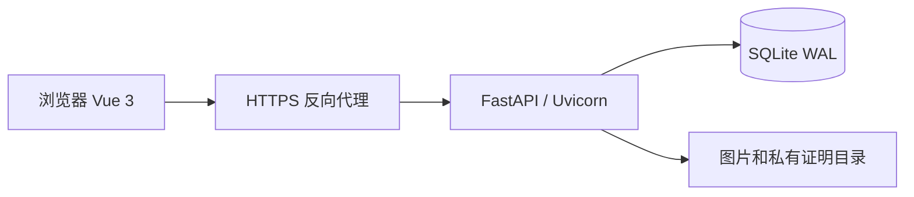

# 架构设计

## 总体结构

夕拾采用单服务、同源 Web 架构。FastAPI 提供 API 与前端静态文件，Vue 通过 JSON 和 Cookie 会话调用接口。服务器部署时可由 Caddy 或平台代理提供 HTTPS。

本机也可直接访问 Uvicorn。前端无需独立构建或跨域 API 地址，Vue 与 SVG 素材随仓库保存。

## 模块职责

| 模块 | 职责 |
|---|---|
| backend/main.py | 会话、商品、搜索、收藏、留言、图片、个人资料及密码修改 |
| backend/campus.py | 兼容迁移、认证、求购、消息、线下订单、管理与举报 |
| backend/recovery.py | 安全问题配置、恢复尝试限制和密码重置 |
| backend/schema.sql | 基础表结构、索引与约束 |
| frontend/app.js | 商品列表、搜索、表单、登录及基础交互 |
| frontend/campus.js | 校园业务导航、审核、求购与交易操作 |
| frontend/experience.js | 外观、图片预览、资料、恢复和来源消息 |

数据访问采用 sqlite3 参数绑定和上下文事务。单服务结构降低部署复杂度；多实例扩展需要独立数据库和共享文件存储。

## 数据完整性

金额校验使用 Decimal，数据库存储整数分。每个商品最多一个活动订单，依靠唯一索引约束；订单更新和商品状态联动使用事务。双方确认后完成交易，历史记录不会因商品逻辑删除消失。

数据库启用外键与 WAL。启动时按现有列和表执行兼容迁移，不重置已有账号、商品和订单。数据目录由 MARKET_DATA_DIR 配置。

## 身份与隐私

会话使用 32 字节随机令牌，浏览器保存 HttpOnly Cookie，数据库仅保存令牌 SHA-256 摘要，默认有效期七天。密码使用 PBKDF2-HMAC-SHA256、独立随机盐和 260000 次迭代。

请求模型由 Pydantic 校验；角色、认证、资源所有权和会话参与者由服务端检查。公开列表不返回联系方式；认证图片仅本人和管理员可取。上传文件经真实内容解码和重编码，避免仅信任扩展名。

安全问题保存答案摘要，恢复时核验全部配置并撤销旧会话。恢复次数按账号和客户端 IP 限制；这不等同于完整身份恢复或生产级登录防护。

## 前端状态

列表加载使用请求序号避免旧结果覆盖新筛选。服务端保存商品、订单和会话；localStorage 只保存布局偏好。搜索历史按账号或设备隔离。消息通过轮询更新，来源类型区分商品、求购和直接私信。

三种布局共用组件和业务状态；侧栏分组与横栏菜单提供一致导航。登录弹窗的关闭行为与密码草稿清理由状态监听处理。

## 部署边界

默认使用单个 Uvicorn 工作进程。CloudStudio 暴露一个 HTTPS 预览端口，前端和 API 同源；其他环境可以使用 Docker Compose / Caddy。实际部署需验证 HTTPS Cookie、代理来源、数据卷和备份恢复。
