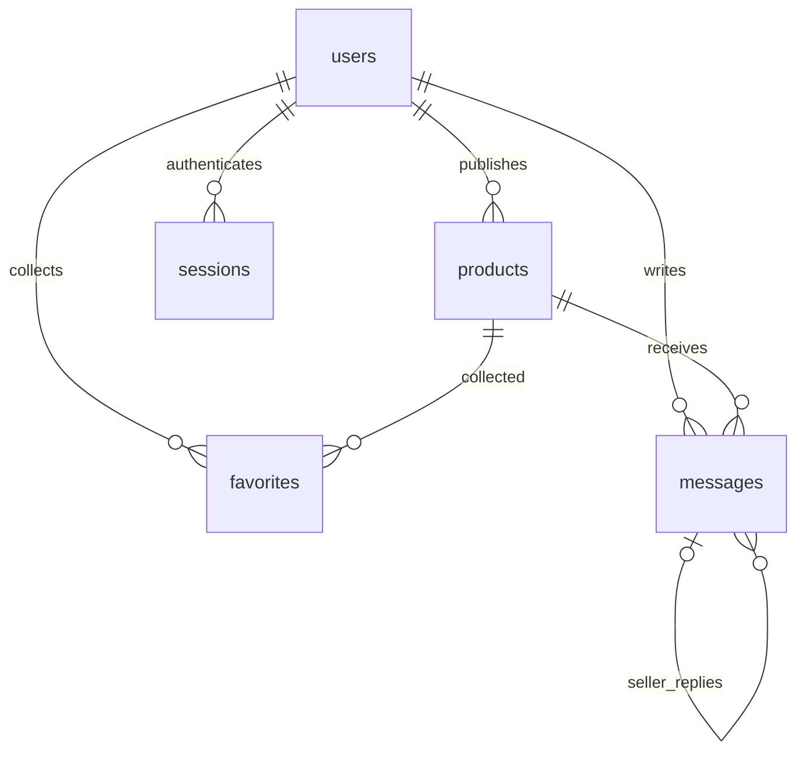

# 数据库设计

文档编号 SGM-DB-001 · 版本 1.0 · 日期 2026-10-18

## 1. 设计原则

采用 SQLite，默认文件 `data/market.db`。通过 `MARKET_DATA_DIR` 可整体迁移持久化目录。所有连接启用 `PRAGMA foreign_keys=ON`，初始化开启 WAL。实际 DDL 以 `backend/schema.sql` 为准，可直接初始化。

## 2. 实体关系

## 3. 数据字典

### users 用户表

| 字段 | 类型 / 约束 | 含义 |
|---|---|---|
| id | INTEGER PK | 用户标识，SQLite 自动生成 |
| username | TEXT NOT NULL UNIQUE | 登录名；应用校验 3–30 位 |
| nickname | TEXT NOT NULL | 公开昵称，最长 24 字 |
| password_hash | TEXT NOT NULL | salt:PBKDF2 结果；不返回客户端 |
| created_at | TEXT NOT NULL DEFAULT CURRENT_TIMESTAMP | UTC 创建时间 |

### sessions 登录会话

| 字段 | 类型 / 约束 | 含义 |
|---|---|---|
| token_hash | TEXT PK | Cookie token 的 SHA-256 摘要 |
| user_id | INTEGER NOT NULL FK users(id) | 会话用户，用户删除时级联 |
| expires_at | INTEGER NOT NULL | Unix 秒；小于等于当前时间失效 |

### products 商品表

| 字段 | 类型 / 约束 | 含义 |
|---|---|---|
| id | INTEGER PK | 商品 ID |
| owner_id | INTEGER NOT NULL FK users(id) | 发布者，服务端写入 |
| title | TEXT NOT NULL | 标题 2–80 字 |
| description | TEXT NOT NULL | 描述 5–3000 字 |
| price_cents | INTEGER NOT NULL CHECK >=0 | 金额分，如 12.34 元存 1234 |
| category | TEXT NOT NULL | 固定六类，应用枚举校验 |
| image_url | TEXT NOT NULL | 本地路径或 HTTPS 图片链接 |
| contact | TEXT NOT NULL | 联系方式；游客不可见 |
| location | TEXT NOT NULL | 面交地点 |
| condition | TEXT NOT NULL | 四种成色，应用枚举校验 |
| status | TEXT NOT NULL DEFAULT on_sale / CHECK | on_sale、off_shelf、sold |
| created_at | TEXT NOT NULL DEFAULT CURRENT_TIMESTAMP | UTC 发布时间 |
| updated_at | TEXT NOT NULL DEFAULT CURRENT_TIMESTAMP | 编辑 / 状态变更时由 SQL 更新 |

### favorites 收藏关系

| 字段 | 类型 / 约束 | 含义 |
|---|---|---|
| user_id | INTEGER NOT NULL FK users(id) | 收藏者 |
| product_id | INTEGER NOT NULL FK products(id) | 收藏商品 |
| created_at | TEXT NOT NULL DEFAULT CURRENT_TIMESTAMP | 收藏时间 |

联合主键 `(user_id, product_id)`；用户或商品删除时级联删除收藏。本版没有删除用户 / 商品的公开接口。

### messages 留言和回复

| 字段 | 类型 / 约束 | 含义 |
|---|---|---|
| id | INTEGER PK | 留言 ID |
| product_id | INTEGER NOT NULL FK products(id) | 所属商品，删除商品时级联 |
| user_id | INTEGER NOT NULL FK users(id) | 作者 |
| content | TEXT NOT NULL | 去空白后 1–500 字 |
| parent_id | INTEGER NULL FK messages(id) | NULL 为根留言，非 NULL 为卖家回复 |
| created_at | TEXT NOT NULL DEFAULT CURRENT_TIMESTAMP | UTC 留言时间 |

回复必须属于同一商品、指向根留言且作者为卖家；这些是应用层约束，不由当前外键独立保证。直接离线写数据库时应遵守同样规则。

## 4. 索引与查询

`idx_products_status_category(status,category,price_cents)` 支持状态、分类及价格过滤；`idx_products_owner(owner_id)` 用于个人商品；`idx_messages_product(product_id,id)` 用于按商品读取留言。唯一用户名、会话主键与收藏联合主键自动产生相应索引。

关键词使用 `instr(lower(title), lower(?))` 或描述匹配，按原文子串处理，不把 `%`、`_` 当通配符；需要扫描候选记录，适用于课程规模。大数据量可用 FTS5 或专用检索服务；本版未做性能基准。

## 5. 事务与一致性

一次写操作对应一个事务，成功提交、异常回滚。收藏冲突按幂等处理。用户注册唯一约束冲突返回 409。金额先由 Pydantic Decimal 校验精度，再转成整数分，避免浮点累计误差。0 元允许用于赠送。

初始化使用 `CREATE TABLE IF NOT EXISTS`，不会删除已有数据；它不属于完整数据库迁移系统。未来字段升级必须先备份并新增显式迁移脚本，不能依赖初始化 SQL 自动改变旧表。

## 6. 备份与隐私

停服务后复制整个 data 目录，或使用 SQLite backup API 得到一致性数据库快照并同时备份 uploads。不能仅在写入中复制 market.db 而漏掉 WAL。联系方式和会话信息不能作为公开数据集。交付压缩包排除运行数据库，演示数据由显式脚本重建。
